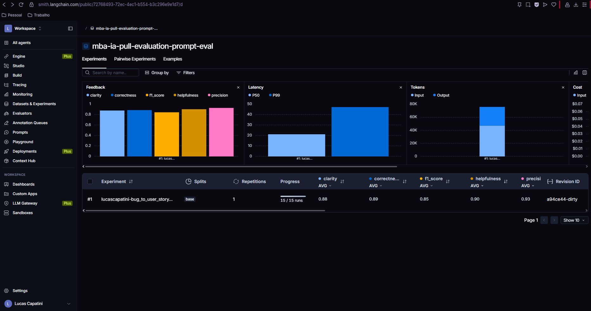
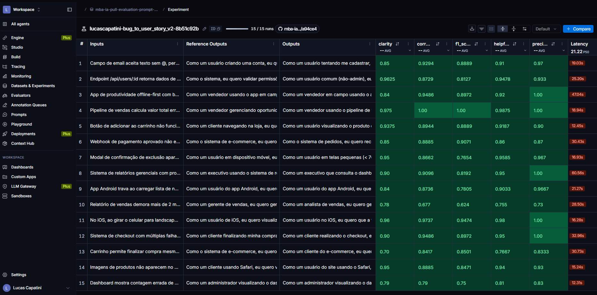
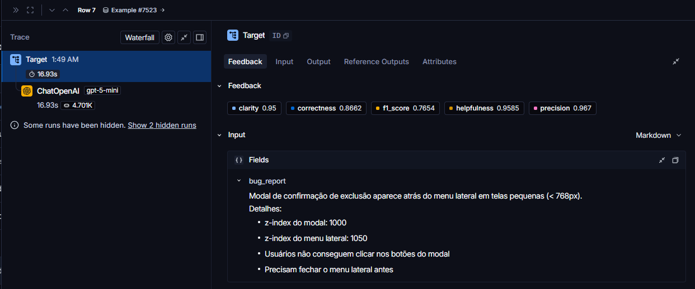
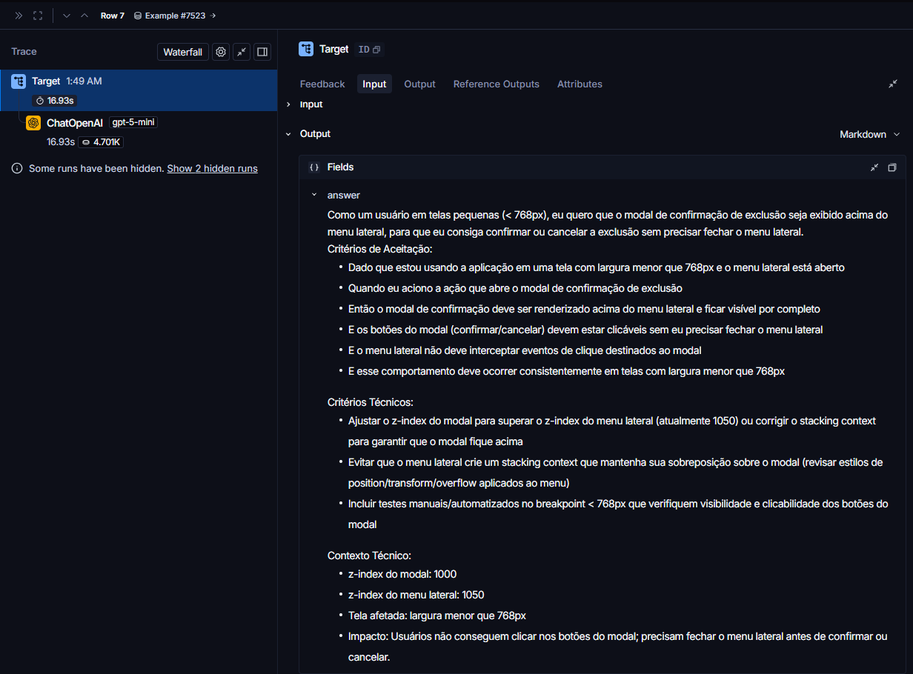
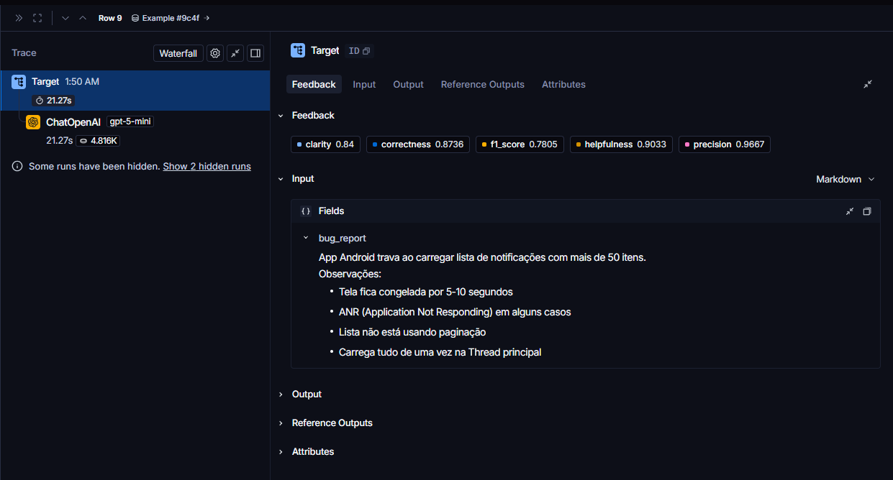
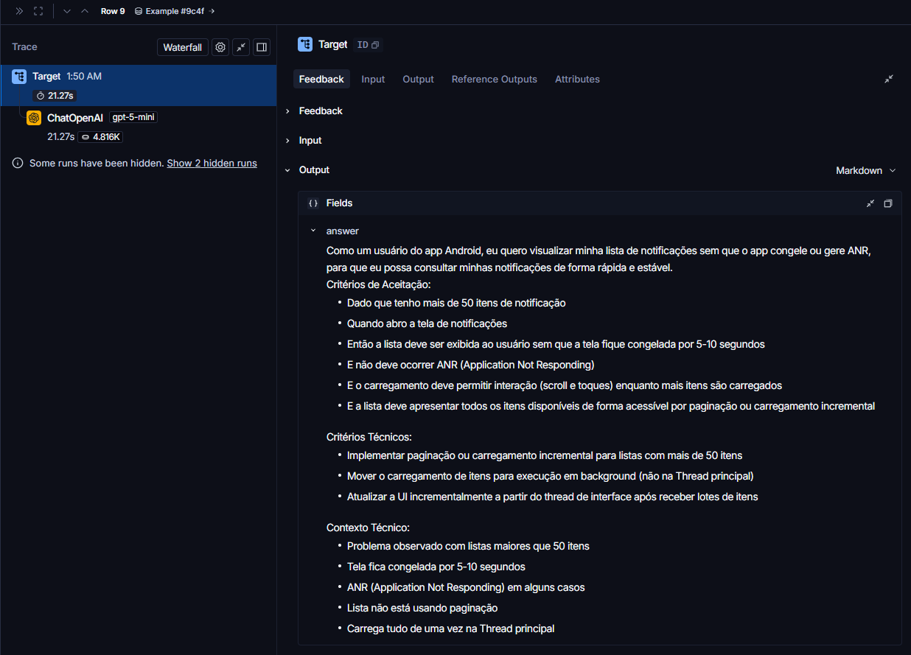
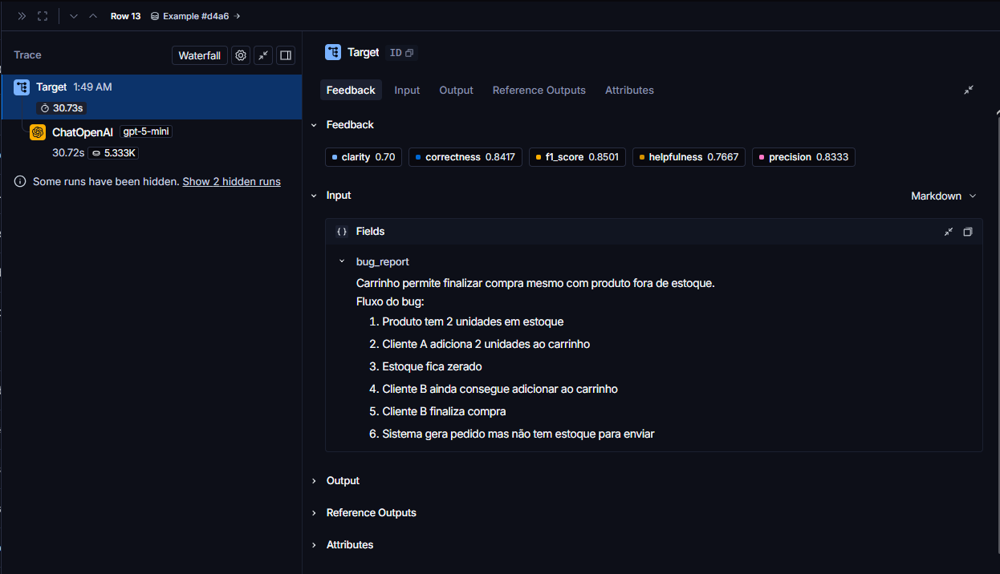
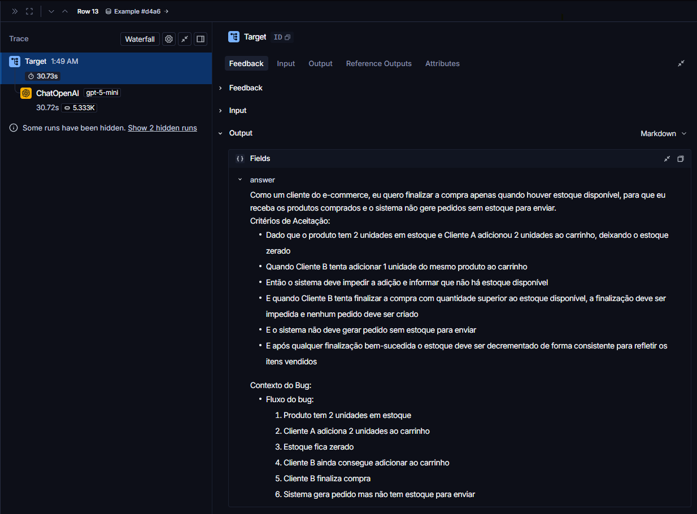

# Pull, Otimização e Avaliação de Prompts com LangChain e LangSmith

## Objetivo

Você deve entregar um software capaz de:

- Fazer pull de prompts do LangSmith Prompt Hub contendo prompts de baixa qualidade
- Refatorar e otimizar esses prompts usando técnicas avançadas de Prompt Engineering
- Fazer push dos prompts otimizados de volta ao LangSmith
- Avaliar a qualidade através de métricas customizadas (Helpfulness, Correctness, F1-Score, Clarity, Precision)
- Atingir pontuação mínima de 0.8 (80%) em todas as métricas de avaliação

## Exemplo no CLI

Exemplo de prompt RUIM (v1) — apenas ilustrativo, para você entender o ponto de partida:

```
==================================================
Prompt: {seu_username}/bug_to_user_story_v1
==================================================

Métricas Derivadas:
  - Helpfulness: 0.45 ✗
  - Correctness: 0.52 ✗

Métricas Base:
  - F1-Score: 0.48 ✗
  - Clarity: 0.50 ✗
  - Precision: 0.46 ✗

❌ STATUS: REPROVADO
⚠️  Métricas abaixo de 0.8: helpfulness, correctness, f1_score, clarity, precision
```

Exemplo de prompt OTIMIZADO (v2) — seu objetivo é chegar aqui:

```
# Após refatorar os prompts e fazer push
python src/push_prompts.py

# Executar avaliação
python src/evaluate.py

Executando avaliação dos prompts...
==================================================
Prompt: {seu_username}/bug_to_user_story_v2
==================================================

Métricas Derivadas:
  - Helpfulness: 0.94 ✓
  - Correctness: 0.96 ✓

Métricas Base:
  - F1-Score: 0.93 ✓
  - Clarity: 0.95 ✓
  - Precision: 0.92 ✓

✅ STATUS: APROVADO - Todas as métricas >= 0.8

Resultados no LangSmith (notas gravadas como feedback no experimento):
  {seu_username}/bug_to_user_story_v2
    https://smith.langchain.com/o/.../datasets/.../compare?selectedSessions=...
```

## Tecnologias obrigatórias

- Linguagem: Python 3.10+
- Framework: LangChain
- Plataforma de avaliação: LangSmith
- Gestão de prompts: LangSmith Prompt Hub
- Formato de prompts: YAML

## Pacotes recomendados

```python
from langsmith import Client  # Pull/push de prompts, datasets e avaliação
from langchain_core.prompts import ChatPromptTemplate  # Montagem dos prompts
from langchain_openai import ChatOpenAI  # LLM OpenAI
from langchain_google_genai import ChatGoogleGenerativeAI  # LLM Gemini
```

## OpenAI

- Crie uma API Key da OpenAI: https://platform.openai.com/api-keys
- Você vai precisar de um modelo de LLM para responder e de um modelo de LLM para avaliação. Consulte a documentação oficial da OpenAI para ver os modelos disponíveis.
- Custo estimado: ~$1-5 para completar o desafio

## Gemini (modelo free)

- Crie uma API Key da Google: https://aistudio.google.com/app/apikey
- Você vai precisar de um modelo de LLM para responder e de um modelo de LLM para avaliação. Consulte a documentação oficial do Google para ver os modelos disponíveis.
- Os limites de requisições gratuitas mudam com frequência. Consulte os limites atuais na documentação oficial do Google.

## Escolha dos modelos

Este desafio não fixa modelos. Nomes e versões mudam com frequência e alguns são descontinuados, então faz parte do desafio consultar a documentação oficial do provedor que você escolher, ver quais modelos estão disponíveis no momento e selecionar os que atendem ao objetivo. Você pode usar o mesmo modelo para responder e para avaliar, ou um modelo mais capaz na avaliação.

## Handle do LangSmith Hub (seu username)

O LangSmith identifica os prompts que você publica por um **handle público**, no
formato `handle/nome_do_prompt`. Esse handle é o valor que vai em
`USERNAME_LANGSMITH_HUB` no `.env`.

Ele **não existe por padrão**: é criado no momento em que você torna um prompt
público pela primeira vez. Por isso, faça esta etapa antes de tentar o push:

1. Abra o LangSmith e vá em **Prompts**
2. Crie um prompt qualquer (pode ser de teste) ou abra um que você já tenha
3. Clique nos **três pontinhos** no canto superior direito, ao lado do botão **Playground**
4. Escolha **Make Public**
5. Na tela **Choose your public handle**, defina o seu handle

O handle é **definitivo** depois de confirmado, então escolha com calma. Feito
isso, ele aparece no endereço do prompt (`handle/nome_do_prompt`) e é esse valor
que você coloca no `.env`.

## Requisitos

### 1. Pull do Prompt inicial do LangSmith

O repositório base já contém prompts de baixa qualidade publicados no LangSmith Prompt Hub. Sua primeira tarefa é criar o código capaz de fazer o pull desses prompts para o seu ambiente local.

Tarefas:

- Criar seu handle do LangSmith Hub (ver a seção "Handle do LangSmith Hub" acima)
- Configurar suas credenciais do LangSmith no arquivo .env (conforme o arquivo .env.example)
- Implementar o script src/pull_prompts.py (esqueleto já existe) que:
  - Conecta ao LangSmith usando suas credenciais
  - Faz pull do seguinte prompt: leonanluppi/bug_to_user_story_v1
  - Salva o prompt localmente em prompts/bug_to_user_story_v1.yml

Atenção: o LangSmith bloqueia por padrão o pull de prompts identificados por
`owner/nome`, porque um prompt do Hub é um objeto LangChain serializado e pode vir
de terceiros. Para o prompt semente do desafio, passe `dangerously_pull_public_prompt=True`
no `client.pull_prompt(...)`.

### 2. Otimização do Prompt

Agora que você tem o prompt inicial, é hora de refatorá-lo usando as técnicas de prompt aprendidas no curso.

Tarefas:

- Analisar o prompt em prompts/bug_to_user_story_v1.yml
- Criar um novo arquivo prompts/bug_to_user_story_v2.yml com suas versões otimizadas
- Aplicar obrigatoriamente Few-shot Learning (exemplos claros de entrada/saída) e pelo menos uma das seguintes técnicas adicionais:
  - Chain of Thought (CoT): Instruir o modelo a "pensar passo a passo"
  - Tree of Thought: Explorar múltiplos caminhos de raciocínio
  - Skeleton of Thought: Estruturar a resposta em etapas claras
  - ReAct: Raciocínio + Ação para tarefas complexas
  - Role Prompting: Definir persona e contexto detalhado
- Documentar no README.md quais técnicas você escolheu e por quê

Requisitos do prompt otimizado:

- Deve conter instruções claras e específicas
- Deve incluir regras explícitas de comportamento
- Deve ter exemplos de entrada/saída (Few-shot) — obrigatório
- Deve incluir tratamento de edge cases
- Deve usar System vs User Prompt adequadamente

### 3. Push e Avaliação

Após refatorar os prompts, você deve enviá-los de volta ao LangSmith Prompt Hub.

Tarefas:

- Implementar o script src/push_prompts.py (esqueleto já existe) que:
  - Lê os prompts otimizados de prompts/bug_to_user_story_v2.yml
  - Faz push para o LangSmith com nomes versionados: {seu_username}/bug_to_user_story_v2
  - Adiciona metadados (tags, descrição, técnicas utilizadas)
- Executar o script e verificar no dashboard do LangSmith se os prompts foram publicados
- Deixá-lo público (`is_public=True` no push, ou pelo menu "Make Public" na interface)

Lembre-se de que `{seu_username}` é o handle do Hub, e ele só existe depois de você
ter tornado algum prompt público pelo menos uma vez.

### 4. Iteração

Espera-se 3-5 iterações.

- Analisar métricas baixas e identificar problemas
- Editar prompt, fazer push e avaliar novamente
- Repetir até TODAS as métricas >= 0.8

Cada execução do `src/evaluate.py` cria um **experimento** no LangSmith, ligado ao
dataset de avaliação. As 5 notas são gravadas como feedback em cada exemplo, o que
permite comparar suas iterações lado a lado no dashboard. Ao final, o script imprime
o link direto do experimento.

```
Critério de Aprovação:
- Helpfulness >= 0.8
- Correctness >= 0.8
- F1-Score >= 0.8
- Clarity >= 0.8
- Precision >= 0.8

MÉDIA das 5 métricas >= 0.8
```

IMPORTANTE: TODAS as 5 métricas devem estar >= 0.8, não apenas a média!

### 5. Testes de Validação

O que você deve fazer: Edite o arquivo tests/test_prompts.py e implemente, no mínimo, os 6 testes abaixo usando pytest:

- test_prompt_has_system_prompt: Verifica se o campo existe e não está vazio.
- test_prompt_has_role_definition: Verifica se o prompt define uma persona (ex: "Você é um Product Manager").
- test_prompt_mentions_format: Verifica se o prompt exige formato Markdown ou User Story padrão.
- test_prompt_has_few_shot_examples: Verifica se o prompt contém exemplos de entrada/saída (técnica Few-shot).
- test_prompt_no_todos: Garante que você não esqueceu nenhum [TODO] no texto.
- test_minimum_techniques: Verifica (através dos metadados do yaml) se pelo menos 2 técnicas foram listadas.

Como validar:

```
pytest tests/test_prompts.py
```

## Estrutura obrigatória do projeto

Faça um fork do repositório base: https://github.com/devfullcycle/mba-ia-pull-evaluation-prompt

```
mba-ia-pull-evaluation-prompt/
├── .env.example              # Template das variáveis de ambiente
├── requirements.txt          # Dependências Python
├── README.md                 # Sua documentação do processo
│
├── prompts/
│   ├── bug_to_user_story_v1.yml  # Prompt inicial (já incluso)
│   └── bug_to_user_story_v2.yml  # Seu prompt otimizado (criar)
│
├── datasets/
│   └── bug_to_user_story.jsonl   # 15 exemplos de bugs (já incluso)
│
├── src/
│   ├── pull_prompts.py       # Pull do LangSmith (implementar)
│   ├── push_prompts.py       # Push ao LangSmith (implementar)
│   ├── evaluate.py           # Avaliação automática (pronto)
│   ├── metrics.py            # 5 métricas implementadas (pronto)
│   └── utils.py              # Funções auxiliares (pronto)
│
├── tests/
│   └── test_prompts.py       # Testes de validação (implementar)
```

O que você deve implementar:

- prompts/bug_to_user_story_v2.yml — Criar do zero com seu prompt otimizado
- src/pull_prompts.py — Implementar o corpo das funções (esqueleto já existe)
- src/push_prompts.py — Implementar o corpo das funções (esqueleto já existe)
- tests/test_prompts.py — Implementar os 6 testes de validação (esqueleto já existe)
- README.md — Documentar seu processo de otimização

O que já vem pronto (não alterar):

- src/evaluate.py — Script de avaliação completo (cria o experimento no LangSmith e grava as notas como feedback)
- src/metrics.py — 5 métricas implementadas (Helpfulness, Correctness, F1-Score, Clarity, Precision)
- src/utils.py — Funções auxiliares
- datasets/bug_to_user_story.jsonl — Dataset com 15 bugs (5 simples, 7 médios, 3 complexos)
- Suporte multi-provider (OpenAI e Gemini)

## VirtualEnv para Python

Crie e ative um ambiente virtual antes de instalar dependências:

```
python3 -m venv venv
source venv/bin/activate  # No Windows: venv\Scripts\activate
pip install -r requirements.txt
```

## Ordem de execução

1. Executar pull dos prompts ruins

```
python src/pull_prompts.py
```

2. Refatorar prompts

Edite manualmente o arquivo prompts/bug_to_user_story_v2.yml aplicando as técnicas aprendidas no curso.

3. Fazer push dos prompts otimizados

```
python src/push_prompts.py
```

4. Executar avaliação

```
python src/evaluate.py
```

## Entregável

1. Repositório público no GitHub (fork do repositório base) contendo:

- Todo o código-fonte implementado
- Arquivo prompts/bug_to_user_story_v2.yml 100% preenchido e funcional
- Arquivo README.md atualizado

2. README.md deve conter:

A) Seção "Técnicas Aplicadas (Fase 2)":

- Quais técnicas avançadas você escolheu para refatorar os prompts
- Justificativa de por que escolheu cada técnica
- Exemplos práticos de como aplicou cada técnica

B) Seção "Resultados Finais":

- Link público do dataset de avaliação, com os experimentos (ver "Evidências no LangSmith")
- Screenshots das avaliações com as notas mínimas de 0.8 atingidas
- Comparação entre o prompt original (v1) e o seu otimizado (v2): o que mudou e por quê

C) Seção "Como Executar":

- Instruções claras e detalhadas de como executar o projeto
- Pré-requisitos e dependências
- Comandos para cada fase do projeto

3. Evidências no LangSmith:

- Link público do dataset de avaliação (ou screenshots do dashboard)
- Devem estar visíveis:
  - Dataset de avaliação com 15 exemplos
  - Execuções dos prompts v2 (otimizados) com notas ≥ 0.8
  - Tracing detalhado de pelo menos 3 exemplos

O link que o `src/evaluate.py` imprime ao final só abre para quem tem acesso ao seu
workspace. Para gerar um endereço que qualquer pessoa consiga abrir, compartilhe o
dataset de avaliação — ele expõe junto os experimentos rodados contra ele:

```python
from langsmith import Client

print(Client().share_dataset(dataset_name="<seu LANGSMITH_PROJECT>-eval")["url"])
```

Rode uma vez e guarde o endereço: ao compartilhar de novo, o link muda.

## Dicas Finais

- Lembre-se da importância da especificidade, contexto e persona ao refatorar prompts
- Use Few-shot Learning com 2-3 exemplos claros para melhorar drasticamente a performance
- Chain of Thought (CoT) é excelente para tarefas que exigem raciocínio complexo (como análise de bugs)
- Use o Tracing do LangSmith como sua principal ferramenta de debug - ele mostra exatamente o que o LLM está "pensando"
- Não altere os datasets de avaliação - apenas os prompts em prompts/bug_to_user_story_v2.yml
- Itere, itere, itere - é normal precisar de 3-5 iterações para atingir 0.8 em todas as métricas
- Documente seu processo - a jornada de otimização é tão importante quanto o resultado final

---

# Documentação do Processo (entrega)

Tudo abaixo desta linha é a documentação da minha solução. O enunciado original do
desafio foi mantido acima para referência.

## Técnicas Aplicadas (Fase 2)

O prompt otimizado está em `prompts/bug_to_user_story_v2.yml`. Além do Few-shot
Learning (obrigatório), apliquei Role Prompting e Chain of Thought. As três
técnicas estão declaradas no campo `techniques_applied` do YAML e viram tags no
LangSmith Hub no momento do push.

### 1. Few-shot Learning (obrigatório)

**Por quê:** as referências do dataset seguem um formato muito específico
(frase "Como um..., eu quero..., para que..." + "Critérios de Aceitação:" em
Dado/Quando/Então/E, com seções extras só quando o bug é médio ou complexo).
Descrever esse formato em palavras não basta: o modelo precisa *ver* o formato
para reproduzi-lo com fidelidade, e isso impacta diretamente F1-Score (recall em
relação à referência) e Precision (não acrescentar o que não foi pedido).

**Como apliquei:** a seção `## EXEMPLOS` do system prompt traz três pares
entrada/saída, um para cada nível de complexidade do dataset (5 simples, 7 médios,
3 complexos). Os exemplos foram escritos à mão, em domínios diferentes dos do
dataset (recuperação de senha, exportação de fatura, agendamento de consultas),
para ensinar o formato sem contaminar a avaliação com as respostas esperadas.

```
### Exemplo 2 (bug médio)

Entrada:
Exportação de PDF da fatura gera arquivo em branco quando a fatura tem mais de 20 itens.
Detalhes:
- Endpoint: GET /api/invoices/:id/pdf
- Log: "RangeError: Maximum call stack size exceeded" no serviço de renderização
...

Saída esperada:
Como um cliente consultando minhas faturas, eu quero exportar qualquer fatura em PDF
independentemente da quantidade de itens, para que eu possa arquivar e compartilhar
meus comprovantes com o financeiro.

Critérios de Aceitação:
- Dado que tenho uma fatura com mais de 20 itens
- Quando solicito a exportação em PDF
- Então o arquivo deve ser gerado com todos os itens da fatura
...

Contexto Técnico:
- Endpoint afetado: GET /api/invoices/:id/pdf
- Erro registrado: "RangeError: Maximum call stack size exceeded" ...
```

### 2. Role Prompting

**Por quê:** o v1 usava "um assistente que ajuda a transformar relatos de bugs",
sem contexto. Uma persona com domínio (Product Owner sênior, times ágeis) muda o
vocabulário, a escolha de persona dentro da própria User Story e o foco em valor
de negócio, que são critérios explícitos dos juízes de Clarity e Precision.

**Como apliquei:** primeira linha do system prompt:

```
Você é um Product Owner sênior com mais de 10 anos de experiência em times ágeis
(Scrum e Kanban). Sua especialidade é transformar relatos de bugs, muitas vezes
vagos ou excessivamente técnicos, em User Stories claras, centradas no usuário e
com critérios de aceitação testáveis, prontas para entrar no backlog...
```

### 3. Chain of Thought (CoT)

**Por quê:** a maior fonte de erro nesse tipo de tarefa é o modelo decidir mal
o nível de detalhe (colocar contexto técnico em bug simples, ou omitir seções em
bug complexo) e inventar dados. Um roteiro de raciocínio em etapas força o modelo a
classificar a complexidade, escolher a persona e listar os fatos do relato *antes*
de escrever, o que reduz omissões (recall) e alucinações (precision).

**Como apliquei:** seção `## PROCESSO DE RACIOCÍNIO` com 7 passos (classificar
complexidade, identificar persona, identificar ação e benefício, listar fatos
concretos, escrever critérios, decidir seções extras, revisar), encerrada por
"Não escreva o raciocínio. Entregue apenas a User Story final." O raciocínio é
interno para não poluir a saída, já que o juiz de Precision penaliza texto fora
do que foi pedido.

### Outros ajustes em relação ao v1

- `{bug_report}` aparece **só no user prompt**. No v1 ele estava duplicado no
  system e no user prompt, então o modelo recebia o relato duas vezes.
- Separação clara entre System (persona, regras, formato, exemplos) e User
  (apenas o relato e a instrução de gerar).
- Regras explícitas: português do Brasil, texto puro sem Markdown, preservar
  números/endpoints/erros literalmente, não inventar dados (usar `[marcador]`
  quando faltar informação), tamanho proporcional ao relato.
- Tratamento de edge cases: relato vago, relato com passos para reproduzir,
  relato com logs/stack trace, relato com impacto de negócio, relato com vários
  problemas numerados e texto que não é bug.

## Resultados Finais

Configuração usada na avaliação:

| Item | Valor |
|---|---|
| Provider | OpenAI |
| Modelo gerador (`LLM_MODEL`) | gpt-5-mini |
| Modelo juiz (`EVAL_MODEL`) | gpt-5-mini |
| Prompt avaliado | `lucascapatini/bug_to_user_story_v2` |
| Dataset | `mba-ia-pull-evaluation-prompt-eval` (15 exemplos) |
| Experimento | `lucascapatini-bug_to_user_story_v2-8b51c92b` |

### Link público do dataset de avaliação

**https://smith.langchain.com/public/72768493-72ec-4ec1-b554-b3c296e9e1d7/d**

O link público expõe o dataset com os 15 exemplos e, na aba "Experiments", o
experimento `lucascapatini-bug_to_user_story_v2-8b51c92b` com as 5 notas por
exemplo e o tracing de cada execução.

Link interno do experimento (abre apenas para quem tem acesso ao workspace):
https://smith.langchain.com/o/2ffa7e64-70b3-46d2-8134-b985b7d56375/datasets/26330b70-154b-4693-b78d-2bd186327025/compare?selectedSessions=d8f3b545-30cf-4f0e-80b7-3a77a4b87ae0

### Métricas por iteração

| Iteração | Helpfulness | Correctness | F1-Score | Clarity | Precision | Média | Status |
|---|---|---|---|---|---|---|---|
| v2 (iteração 1) | 0.90 ✓ | 0.89 ✓ | 0.84 ✓ | 0.88 ✓ | 0.93 ✓ | 0.8887 | ✅ APROVADO |

O prompt v2 atingiu o critério de aprovação (todas as 5 métricas >= 0.8) na
primeira avaliação, sem necessidade de novas iterações.

### Métricas por exemplo (iteração 1)

A coluna "#" segue a ordem do arquivo `datasets/bug_to_user_story.jsonl`. A
coluna "Linha" é a posição em que o exemplo aparece na tabela do experimento no
LangSmith, para facilitar a conferência pelo link público.

| # | Linha | Bug | Complexidade | Helpfulness | Correctness | F1-Score | Clarity | Precision |
|---|---|---|---|---|---|---|---|---|
| 1 | 5 | Botão de adicionar ao carrinho | simples | 0.92 | 0.89 | 0.89 | 0.94 | 0.90 |
| 2 | 1 | Campo de email sem validação | simples | 0.91 | 0.93 | 0.89 | 0.85 | 0.97 |
| 3 | 11 | Layout quebrado em landscape (iOS) | simples | 0.98 | 0.97 | 0.95 | 0.96 | 1.00 |
| 4 | 15 | Contagem errada no dashboard | simples | 0.81 | 0.79 | 0.75 | 0.79 | 0.83 |
| 5 | 14 | Imagens não aparecem no Safari | simples | 0.94 | 0.89 | 0.85 | 0.95 | 0.93 |
| 6 | 6 | Webhook de pagamento não chamado | médio | 0.86 | 0.89 | 0.91 | 0.85 | 0.87 |
| 7 | 10 | Relatório de vendas lento | médio | 0.76 | 0.68 | 0.62 | 0.78 | 0.73 |
| 8 | 2 | Endpoint sem validação de permissão | médio | 0.95 | 0.87 | 0.81 | 0.96 | 0.93 |
| 9 | 4 | Desconto calculado errado no pipeline | médio | 0.99 | 1.00 | 1.00 | 0.98 | 1.00 |
| 10 | 9 | App Android trava com 50+ notificações | médio | 0.90 | 0.87 | 0.78 | 0.84 | 0.97 |
| 11 | 13 | Compra finalizada sem estoque | médio | 0.77 | 0.84 | 0.85 | 0.70 | 0.83 |
| 12 | 7 | Modal atrás do menu lateral | médio | 0.96 | 0.87 | 0.77 | 0.95 | 0.97 |
| 13 | 12 | Checkout com múltiplas falhas | complexo | 0.95 | 0.95 | 0.90 | 0.90 | 1.00 |
| 14 | 8 | Relatórios gerenciais | complexo | 0.95 | 0.91 | 0.82 | 0.90 | 1.00 |
| 15 | 3 | App offline-first com falhas de sync | complexo | 0.92 | 0.95 | 0.90 | 0.84 | 1.00 |

Leitura dos resultados:

- Os 3 bugs complexos, que exigem a estrutura completa (User Story principal,
  critérios por problema, critérios técnicos, contexto e tasks), tiveram
  Precision 1.00 e todas as demais métricas acima de 0.8. O exemplo 3 do
  few-shot, que ensina exatamente essa estrutura, cumpriu seu papel.
- O exemplo 9 (desconto no pipeline), cuja referência traz uma seção "Exemplo de
  Cálculo", teve nota máxima em F1, Correctness e Precision: o modelo reproduziu
  o detalhamento subtotal/desconto/total apenas com a descrição da seção no
  prompt.
- O ponto mais fraco foi o exemplo 7 (relatório de vendas lento), único abaixo
  de 0.8 nas três métricas base. Os demais exemplos com alguma nota abaixo de
  0.8 (4, 10, 11 e 12) perderam principalmente em F1-Score ou Clarity, não em
  Precision, o que indica diferenças de cobertura e organização em relação à
  referência, e não informação inventada.
- Precision foi a métrica mais alta (0.93), o que confirma que as regras de
  "usar somente informações do relato" e "tamanho proporcional ao relato"
  evitaram alucinações e seções desnecessárias.
- Nos traces capturados (abaixo), o modelo preservou os dados técnicos do
  relato (z-index, limites de itens, fluxo do bug) e adicionou seções extras
  apenas em bugs médios, como previsto no prompt. No exemplo 11 (estoque), ele
  copiou o fluxo numerado inteiro para o "Contexto do Bug" em vez de resumi-lo,
  o que explica a Clarity de 0.70.

### Screenshots

Evidências capturadas no LangSmith (arquivos em `docs/`). Os traces estão
identificados pela linha do experimento no LangSmith ("row"), e cada um tem
duas imagens: input com as notas de feedback, e output gerado pelo modelo.

| Evidência | Arquivo |
|---|---|
| Dataset público com os 15 exemplos e o experimento com as 5 médias | `docs/01-dataset.png` |
| Experimento v2 com as 5 métricas por exemplo (15/15 runs) | `docs/02-experimento-metricas.png` |
| Tracing da linha 7 = exemplo 12 (modal atrás do menu lateral): input e notas | `docs/03-tracing-row-07-input-and-notes.png` |
| Tracing da linha 7 = exemplo 12: output | `docs/03-tracing-row-07-output.png` |
| Tracing da linha 9 = exemplo 10 (app Android trava): input e notas | `docs/03-tracing-row-09-input-and-notes.png` |
| Tracing da linha 9 = exemplo 10: output | `docs/03-tracing-row-09-output.png` |
| Tracing da linha 13 = exemplo 11 (compra sem estoque): input e notas | `docs/03-tracing-row-13-input-and-notes.png` |
| Tracing da linha 13 = exemplo 11: output | `docs/03-tracing-row-13-output.png` |

















### Comparação v1 vs v2: o que mudou e por quê

| Aspecto | v1 | v2 |
|---|---|---|
| Persona | "um assistente que ajuda" | Product Owner sênior, com contexto de times ágeis |
| Formato de saída | não especificado | template exato por nível de complexidade (simples, médio, complexo) |
| Exemplos | nenhum | 3 exemplos entrada/saída (few-shot) |
| Raciocínio | nenhum | processo em 7 etapas antes de responder (CoT interno) |
| Regras | nenhuma | idioma, fidelidade aos dados, proibição de inventar, tamanho proporcional |
| Edge cases | nenhum | 6 casos especiais cobertos |
| `{bug_report}` | duplicado (system + user) | somente no user prompt |

O v1 não foi avaliado numericamente neste repositório porque `src/evaluate.py`
avalia apenas o prompt v2 (o enunciado traz a referência ilustrativa de um v1 com
notas na faixa de 0.45 a 0.52). As mudanças acima atacam diretamente as causas
desse desempenho: sem persona e sem formato definido, o modelo produz User Stories
com estrutura inconsistente (prejudica F1 e Clarity) e tende a acrescentar
explicações e sugestões não pedidas (prejudica Precision). Com o v2, a estrutura
é previsível e a saída contém apenas o que a referência espera.

## Como Executar

### Pré-requisitos

- Python 3.10+ (desenvolvido com 3.13)
- Conta no [LangSmith](https://smith.langchain.com) com API key e handle público
  do Hub (ver seção "Handle do LangSmith Hub" acima)
- API key da OpenAI (provider escolhido neste projeto)

### 1. Ambiente

```bash
python -m venv venv
source venv/bin/activate        # Windows: venv\Scripts\activate
pip install -r requirements.txt
cp .env.example .env
```

Preencha o `.env`:

| Variável | Valor |
|---|---|
| `LANGSMITH_API_KEY` | sua chave do LangSmith |
| `LANGSMITH_PROJECT` | nome do projeto de tracing; também nomeia o dataset `<projeto>-eval` |
| `USERNAME_LANGSMITH_HUB` | seu handle público do Hub |
| `OPENAI_API_KEY` | sua chave da OpenAI |
| `LLM_PROVIDER` | `openai` |
| `LLM_MODEL` | modelo que gera a User Story (precisa aceitar `temperature=0`) |
| `EVAL_MODEL` | modelo juiz das métricas (pode ser o mesmo ou um mais capaz) |

As versões em `requirements.txt` são obrigatórias: os scripts usam `response.text`
como propriedade, que só existe no `langchain-core` 1.x.

### 2. Pull do prompt inicial

```bash
python src/pull_prompts.py
```

Puxa `leonanluppi/bug_to_user_story_v1` do Hub e grava em
`prompts/bug_to_user_story_v1.yml`.

### 3. Testes de validação do prompt v2

```bash
pytest tests/test_prompts.py -v
```

Valida `prompts/bug_to_user_story_v2.yml`: system prompt presente, persona
definida, formato exigido, exemplos few-shot, ausência de TODOs, mínimo de duas
técnicas e uso exclusivo da variável `{bug_report}`.

### 4. Push do prompt otimizado

```bash
python src/push_prompts.py
```

Lê `prompts/bug_to_user_story_v2.yml`, valida, monta o `ChatPromptTemplate` e
publica como `<USERNAME_LANGSMITH_HUB>/bug_to_user_story_v2` com `is_public=True`,
descrição e tags (incluindo as técnicas aplicadas). Repetir o push sem alterar o
YAML não gera novo commit no Hub.

### 5. Avaliação

```bash
python src/evaluate.py
```

Cria (ou reutiliza) o dataset `<LANGSMITH_PROJECT>-eval` com os 15 exemplos,
puxa o prompt v2 **do Hub** (não do YAML local), roda um experimento no LangSmith
e imprime as 5 métricas e o link do experimento. Toda alteração no YAML exige um
novo push antes de avaliar.

### 6. Link público para a entrega

```python
from langsmith import Client
print(Client().share_dataset(dataset_name="<LANGSMITH_PROJECT>-eval")["url"])
```

Rode uma vez e guarde o endereço: compartilhar de novo gera um link diferente.